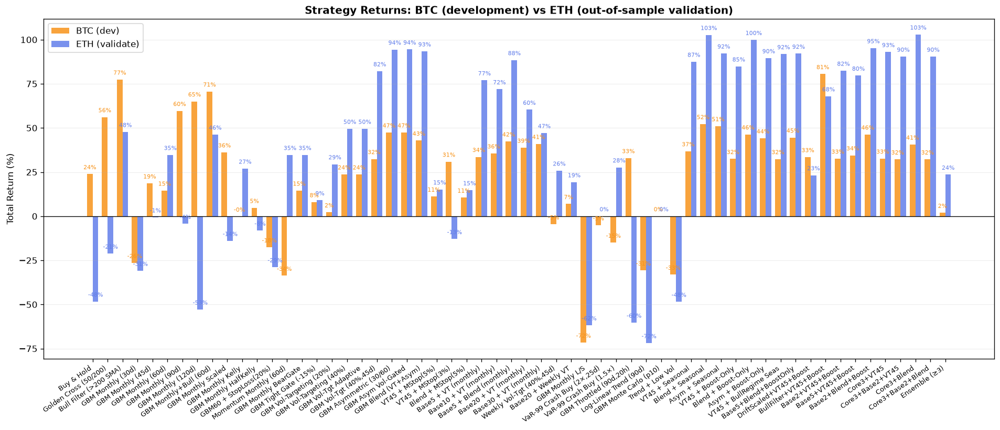
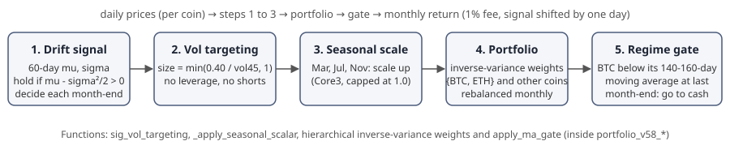
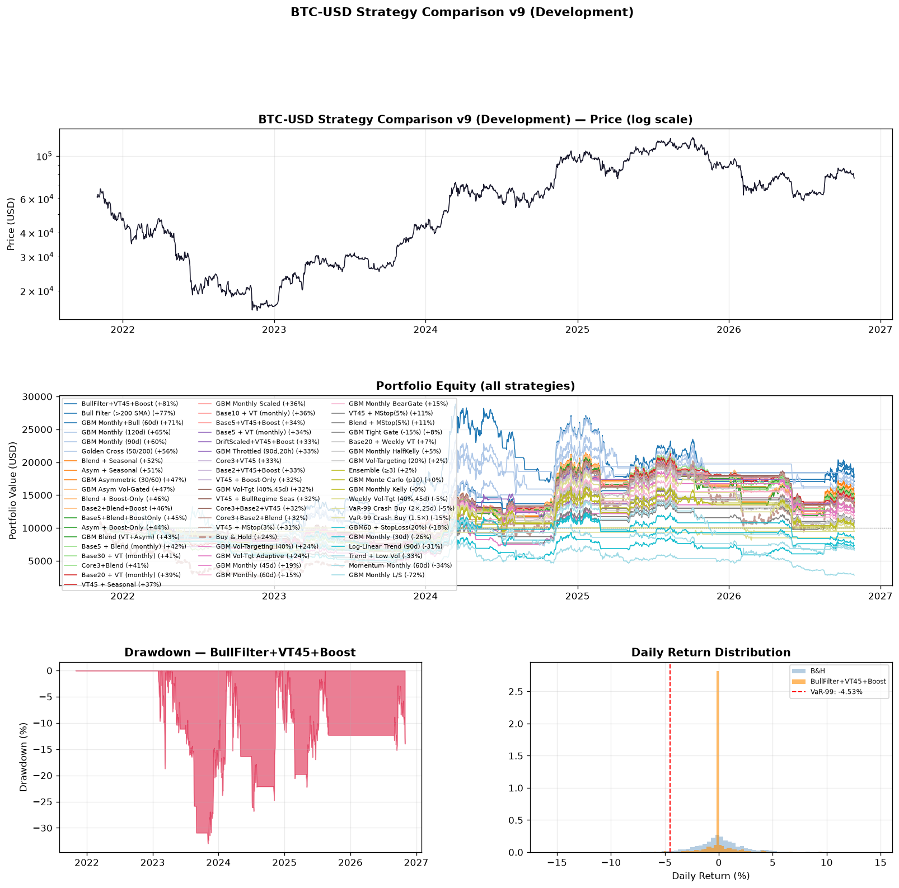

# Crypto Quant Lab

A backtesting study of simple trading rules for crypto coins. The question is:
**can a rule built on recent price drift and volatility beat buy-and-hold after a 1% trading fee?**

The study grew over 59 numbered versions (v1 to v59) in one Python script, from spring 2026.
It starts with single-coin rules on BTC and ETH, and ends with a 6-coin portfolio.



> The original source file was lost. This repository holds source that was **recovered from the
> compiled `.pyc` file** and checked against it. See [How the code was recovered](#how-the-code-was-recovered).

## Data

- Daily prices from Yahoo Finance through `yfinance`: BTC, ETH, SOL, BNB, ADA, AVAX (and a few
  other coins in side tests). The script downloads the last 5 years when it runs.
- Intraday tests use 5-minute bars (last 60 days) and 1-hour bars (last 2 years).
- No price data is stored in this repository. `run.py` downloads it and caches it in `data/cache/`.

## Methods



- **Drift signal.** Over a rolling window (usually 60 days), compute the log-return mean `mu` and
  standard deviation `sigma`. The GBM drift is `mu - sigma^2 / 2`. Hold the coin when the drift is
  positive. Decide once per month, at month-end.
- **Volatility targeting.** Position size is `min(0.40 / realized_vol_45d, 1.0)`. Positions are
  clipped to the range 0 to 1, so there is no leverage and no short selling in the final model.
- **Seasonal scaling.** In March, July and November ("Core3") the position is scaled up (capped at 1.0).
- **Portfolio.** Inverse-variance weights, grouped as {BTC, ETH} and the other coins (a simple
  hierarchical risk parity), rebalanced monthly.
- **Regime gate.** Go to cash when BTC closes below its 140 to 160-day moving average at the
  previous month-end.
- **Costs and look-ahead.** 1% fee on every change of position. Signals are shifted by one day
  before they are traded.
- **Checks.** BTC is the development asset and ETH is the first validation asset. Other checks are
  a Lo (2002) Sharpe-ratio t-test, bootstrap tests, a split into three sub-periods, fee sweeps, and
  side tests with GARCH volatility, intraday bars and more coins.

## Results

All "fresh" numbers come from one run on 2026-10-30, with data from 2021-10-31 to 2026-10-30
([full log](results/run_log.txt)). The "original" numbers are from the author's own notes from May 2026,
when the 5-year window was about 2021-05 to 2026-05.

**Final model (v58; v59 tested one change and kept v58).** 6 coins, 1% fee:

| Metric | Original run (May 2026 notes) | Fresh run (2026-10-30) |
|---|---|---|
| Cumulative return, 5 years | +1610.6% | +1453.3% |
| Sharpe ratio | 0.88 | 0.86 |
| Max drawdown | -17.1% | -17.1% |
| Calmar ratio | 5.03 | 4.80 |
| Sub-period P1 (start to mid-2023) | +20.6% | +0.0% |
| Sub-period P2 (2023-24) | +979.9% | +979.9% |
| Sub-period P3 (2025-26) | +31.4% | +43.8% |
| Best BTC moving-average gate | 150 days | 140 days (140, 150 and 160 tie) |

Why the numbers differ: the 5-year window moved forward by about 6 months. The fresh window starts
at the late-2021 top. The model sits in cash through the 2022 bear market, so P1 is 0%. The old
window also held the mid-2021 rally. P2 (2023-24) is inside both windows, and it is identical.

**Buy-and-hold over the same fresh window:** BTC +23.8%, ETH -48.3%, SOL -53.4%, BNB +31.5%.

**Single-coin rules (fresh run):** a 60-day drift rule with volatility targeting (45-day window)
returned +32.4% on BTC and +82.1% on ETH. Buy-and-hold returned +23.8% and -48.3%.

**Intraday:** all tested rules on 5-minute and 1-hour bars lost money after fees (e.g. average Sharpe
-0.6 to -1.8 on 1-hour bars). The study dropped this direction.



## Limitations and honest conclusions

- **Heavy in-sample tuning.** All 59 versions were tuned on the same 5-year data. The final
  numbers are the best of many tries, so they are biased upwards.
- **The sub-period test is not a true out-of-sample test.** P1 to P3 reuse settings that were
  chosen on the full period.
- **One period makes most of the profit.** P2 (the 2023-24 bull market) gives +979.9%. Outside it,
  the model mostly avoids losses. It makes little money.
- **Some printed summary boxes hold fixed text** from the author's May runs (for example
  "CumRet≈+428%" in the v38 box). Only the numbers in the tables are computed on each run.
- **Later work did not confirm the tuning.** The author's later lab notes (September 2026,
  separate code, not in this repository) used strict walk-forward and lockbox tests. They found that
  tuned settings of this kind did not hold up out of sample.
- Fees are a flat 1%. Slippage, funding and taxes are not modelled.

**Conclusion:** simple drift and volatility rules cut drawdowns a lot compared with holding coins.
On this data most of the gain comes from one bull market, and the tuning probably overfits. This is
a learning project. It is not investment advice.

## How the code was recovered

The source file `crypto_quant_lab.py` (v59) was deleted. Only its compiled form survived:
`recovery/crypto_quant_lab.cpython-312.pyc` (Python 3.12 bytecode, 153 top-level functions and
classes, about 9,300 original lines).

1. Two decompilers gave first drafts: [pycdc](https://github.com/zrax/pycdc) and
   [PyLingual](https://github.com/syssec-utd/pylingual). Both fail on Python 3.12 inline list
   comprehensions, so only 69 of 153 functions were correct at this step.
2. The rest was rebuilt by hand, function by function, from the bytecode disassembly.
3. Each function was compiled again with Python 3.12 and compared with the original code object
   (`recovery/verify.py`).

Result:

| Check | Result |
|---|---|
| Functions/classes with identical bytecode, constants, names and variables (nested code included) | **153 of 153** |
| Module-level code (imports, settings, default values, annotations) | same instructions; only line-number `NOP`s differ |
| Full pipeline output, original `.pyc` vs recovered `.py`, same cached data | identical (3,564 lines; plots byte-identical) |

What could not be recovered:

- **Comments.** Bytecode does not store comments, so the file has none.
- **Exact layout.** Blank lines and line breaks are rebuilt from the bytecode line numbers. They are close, but they are not exact.
- **Set element order.** The order in which set elements were typed is unknown. An order was chosen
  that compiles to the same constant.

No logic was added or changed. One setting is overridden at run time and not in the file:
`OUT_DIR` in the recovered file was the author's Desktop path. That path was replaced with `results/figures` in this repository, so the setting now matches what `run.py` uses. This one constant now differs from the `.pyc`.

## Reproduce

```bash
python3.12 -m venv .venv && source .venv/bin/activate
pip install -r requirements.txt
python run.py > results/run_log.txt          # about 7 minutes on a laptop CPU, needs internet
```

Your numbers will differ from the table above, because the 5-year window moves with the date.

To check the recovery yourself (Python 3.12 is required):

```bash
python recovery/verify.py recovery/crypto_quant_lab.cpython-312.pyc crypto_quant_lab.py
python recovery/run_compare.py orig /tmp/cmp/orig > /tmp/cmp/orig.txt
python recovery/run_compare.py src  /tmp/cmp/src  > /tmp/cmp/src.txt
diff /tmp/cmp/orig.txt /tmp/cmp/src.txt       # only the plot folder path differs
```

## Files

| Path | What it is |
|---|---|
| `crypto_quant_lab.py` | The recovered research script (v59) |
| `run.py` | Runs the full pipeline, caches data, saves plots |
| `results/run_log.txt` | Full output of the fresh run (2026-10-30) |
| `results/figures/` | Plots made by the script |
| `recovery/` | The original `.pyc` and the tools that check the recovery |

## License

MIT, see [LICENSE](LICENSE).

Part of my portfolio: https://ilyaeis.github.io/
